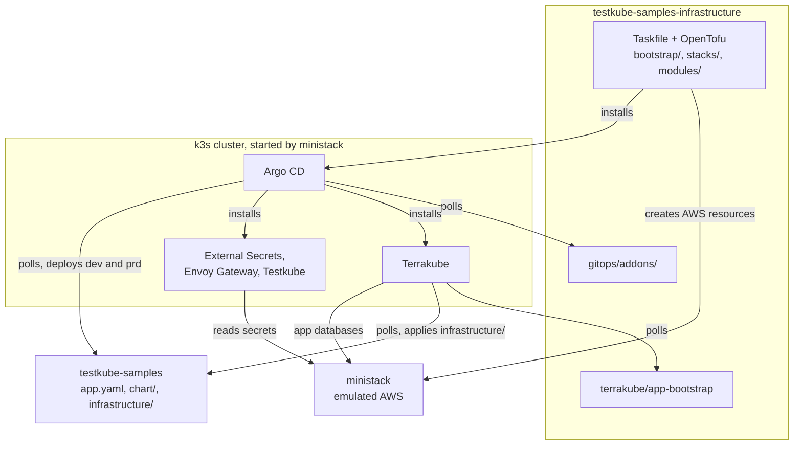
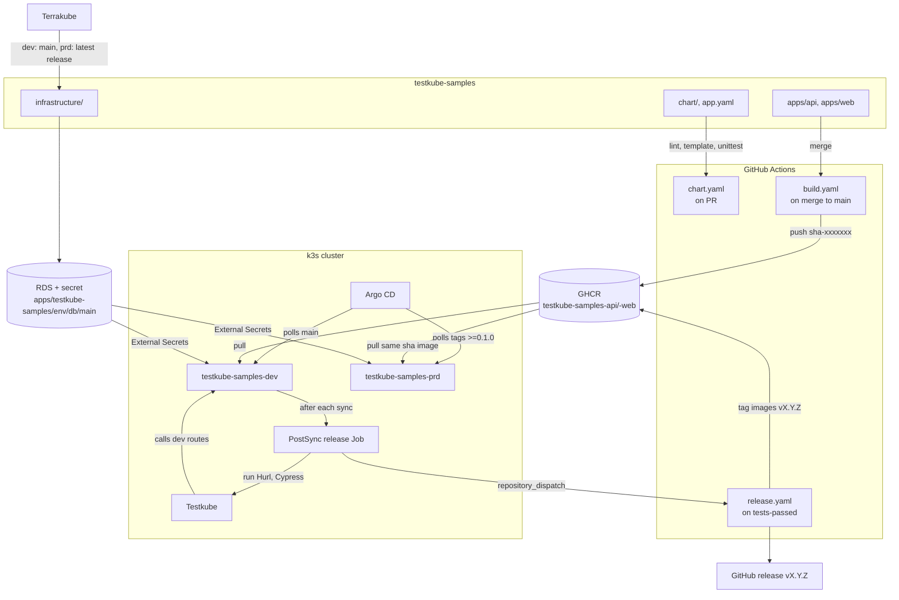

# testkube-samples-infrastructure

A small platform that runs on one laptop. It deploys a sample app, tests it with Testkube in
dev, and promotes it to prd when the tests pass. AWS is emulated by
[ministack](https://hub.docker.com/r/ministackorg/ministack), which also runs the Kubernetes
cluster (k3s, behind ministack's EKS API).

It is about exactly two repositories:

- [dkravetz/testkube-samples](https://github.com/dkravetz/testkube-samples): the app. Its code,
  its Helm chart, its `app.yaml` and its own OpenTofu. See [docs/app-repo.md](docs/app-repo.md).
- [dkravetz/testkube-samples-infrastructure](https://github.com/dkravetz/testkube-samples-infrastructure)
  (this one): the platform. Bootstrap, OpenTofu stacks, Argo CD add-ons and Terrakube config.

Tested on macOS only.

## Prerequisites

| Tool | Used for |
| --- | --- |
| Colima, Docker CLI | Runs ministack, the socat container, and the containers ministack starts (k3s, Postgres, Valkey) |
| Task (`task`) | `task bootstrap`, `task urls`, `task down`, ... |
| OpenTofu (`tofu`) | Every root under `bootstrap/` and `stacks/` |
| AWS CLI v2 (`aws`) | The `ministack` profile and `aws eks get-token` for kubectl |
| kubectl | The cluster; `task urls` lists the app's routes with it |
| jq | The `tofu validate` pre-commit hook |
| Helm | Only to update the `Chart.lock` files in `gitops/addons/*`. Argo CD pulls the charts itself. |
| gh | Optional, for working with the two repos |
| pre-commit | Optional, the commit hooks in `.pre-commit-config.yaml` |

`openssl` and `curl` are also called. macOS ships both.

```bash
brew install colima docker go-task opentofu awscli kubernetes-cli jq helm gh pre-commit
```

You also need a GitHub App installed on the `dkravetz` account with access to both repos.
Argo CD, Terrakube and the app's release job all use it. Its ID and installation ID are the
defaults in `stacks/eks/variables.tf` and `stacks/terrakube/variables.tf`. Its private key
(PEM) is shared separately, to keep it out of git. Put it at `.local/github-app.pem`, which is
gitignored. Encrypting it in the repo, with something like `sops`, was out of scope.

## Colima VM

Colima is what this was built and tested with. Any way of running Docker on macOS should work,
but adapting these steps is up to you.

1. Start the VM with the size the Taskfile asks for. Kubernetes in Colima stays off (the
   default): ministack starts its own k3s.

   ```bash
   colima start --vm-type vz --cpu 4 --memory 16 --disk 100
   ```

2. Wait for the command to return. `task bootstrap` checks `colima status` first and stops
   with the same `colima start` line if the VM isn't running.

## Bootstrap

```bash
task bootstrap
```

It runs these steps in order (`Taskfile.yml`, `bootstrap/ministack/Taskfile.yml`):

1. `ministack:up`: creates the Docker network `testkube-poc`, starts the `ministack` container
   on port 4566 (with `AUTH=true`, so IAM is enforced) and a `socat` container that forwards
   the Mac's ports 80 and 443 to the cluster's Envoy Gateway. It waits up to 2 minutes for
   ministack's health check, then writes ministack's IP to `.local/ministack.yaml`.
2. `bootstrap/tofu-state`: an S3 bucket for every stack's state and the IAM role `tofu`. This
   root keeps its own state on disk.
3. `github-app-key`: converts `.local/github-app.pem` to PKCS#8, the only format Terrakube reads.
4. `stacks/vpc`, `stacks/eks`, `stacks/terrakube`, each a plain `tofu init` and `tofu apply`.
   - `stacks/vpc`: the VPC and two private subnets.
   - `stacks/eks`: the EKS cluster (ministack starts a k3s container for it), Argo CD, the
     `addons` ApplicationSet, the local CA and edge certificate, the databases, cache and
     buckets of Terrakube and Testkube, and their secrets in Secrets Manager.
   - `stacks/terrakube`: waits for the Terrakube API (it retries for up to 10 minutes while
     Argo CD installs it), then creates the organization, the GitHub connection and the
     `app-bootstrap` workspace.
5. `kubeconfig`: adds the `ministack` profile to your AWS CLI config and the `testkube-poc`
   cluster to `~/.kube/config`.
6. `urls`: prints the URLs and logins. When you see them, bootstrap is done.

Timings from one run on an Apple Silicon Mac (Colima at 4 CPU, 16 GiB): k3s started 30
seconds after ministack, and every add-on was synced about 3 minutes after ministack started.
The app comes later: Terrakube has to create the app's databases first. Here dev's database
was up after 11 minutes and prd's after 16.

Print the URLs and logins again at any time:

```bash
task urls
```

The platform answers on `*.platform.localhost`: `argocd.`, `terrakube.`, `terrakube-api.` and
`terrakube-registry.`. The app answers on `testkube-samples.dev.localhost` and
`testkube-samples.prd.localhost`. HTTP and HTTPS both work. HTTPS uses a local CA, written to
`.local/ca.crt`. To trust it in your browsers (macOS asks for your password):

```bash
task trust-ca
```

## What gets spun up

| Component | What it does | Owned by |
| --- | --- | --- |
| ministack | Emulated AWS on `localhost:4566`: IAM, STS, S3, EC2, EKS, RDS, ElastiCache, Secrets Manager | `bootstrap/ministack/Taskfile.yml` |
| socat | Forwards the Mac's :80/:443 to the Gateway's NodePorts 30080/30443 | `bootstrap/ministack/Taskfile.yml` |
| State bucket, `tofu` role | OpenTofu state for every stack, and the role each stack assumes | `bootstrap/tofu-state` |
| VPC | Network for the cluster, databases and cache | `stacks/vpc` |
| EKS cluster (k3s) | The one Kubernetes cluster, Kubernetes 1.36 | `stacks/eks`, `modules/eks-cluster` |
| Argo CD | Installs everything else in the cluster from git, and manages itself | `modules/eks-cluster/argocd.tf`, then `gitops/addons/argocd` |
| External Secrets Operator | Copies Secrets Manager secrets into Kubernetes Secrets | `gitops/addons/external-secrets` |
| Envoy Gateway | The one Gateway, `edge`, for every hostname | `gitops/addons/envoy-gateway-system` |
| Terrakube | Runs each app's OpenTofu on a schedule | `gitops/addons/terrakube`, AWS side in `modules/terrakube`, config in `stacks/terrakube` |
| Testkube | Runs the app's Hurl and Cypress tests in dev | `gitops/addons/testkube`, AWS side in `modules/testkube` |
| The app, dev and prd | Namespaces `testkube-samples-dev` and `testkube-samples-prd` | `gitops/addons/apps` here, `chart/` and `app.yaml` in the app repo |
| The app's databases | One RDS Postgres per env, credentials in Secrets Manager | `infrastructure/` in the app repo, run by Terrakube |

## Who does what

| Tool | Does | Reads from |
| --- | --- | --- |
| Taskfile | Starts the Docker containers and runs each OpenTofu root in order. Only from the laptop. | This repo |
| OpenTofu (laptop) | `bootstrap/tofu-state` and `stacks/*`: everything AWS-side the platform needs, the first Argo CD install, the Terrakube config | This repo |
| Argo CD | Installs every add-on under `gitops/addons/`, and the app's dev and prd | This repo's `main`; the app repo's `app.yaml` and `chart/` |
| Terrakube | Runs `terrakube/app-bootstrap`, which creates one workspace per app and env. Those run the app's `infrastructure/`. | This repo's `main`; the app repo |
| GitHub Actions | Only in the app repo: checks the chart, builds images, cuts releases | The app repo |

This repo has no GitHub Actions. Changes to `gitops/` reach the cluster when Argo CD polls
`main`. Changes to `terrakube/app-bootstrap` reach Terrakube on its next scheduled run.
Changes to `stacks/` and `modules/` only apply when you run `tofu apply` from the laptop.

### How Terrakube runs the app's infrastructure

Three levels. Only the first one runs on the laptop.

1. **Once, from the laptop: `stacks/terrakube`** (the last stack of `task bootstrap`). It
   sets up Terrakube: the `testkube-poc` organization, the GitHub connection, the
   `plan-apply` template, and one workspace, `app-bootstrap`, on this repo's
   `terrakube/app-bootstrap` at `main`, scheduled every 5 minutes.
2. **Every 5 minutes, in Terrakube: `app-bootstrap`.** Each run reads the app list
   (`local.apps`), asks GitHub for each app's latest release, and creates or updates two
   workspaces per app: `<app>-dev` on the app repo's `main`, and `<app>-prd` on its latest
   release tag (no prd workspace before the first release). Each gets its own 5-minute
   schedule.
3. **Every 5 minutes, in Terrakube: `<app>-dev` and `<app>-prd`.** Each plans and applies the
   app's OpenTofu (the folder `infrastructure.path` in its `app.yaml`) at its branch or tag.
   That OpenTofu reads its per-env variables from the same `app.yaml`
   ([docs/app-repo.md](docs/app-repo.md#per-env-variables-from-appyaml)).

So a new release reaches prd's infrastructure in two scheduled hops: `app-bootstrap` moves
the prd workspace to the new tag, then prd's next run applies it. Up to 10 minutes, plus the
runs themselves. Nothing triggers a run directly ([tradeoffs](docs/tradeoffs.md)).

## How it fits together

For DevOps: which part of this repo creates what, and how the cluster reads both repos.



For developers: what happens to a change in the app repo.



## How the app's workflows work

**TL;DR:** a merge to `main` deploys to dev, which runs the tests. If the tests pass, the
change is promoted to production automatically.

All of this happens in [dkravetz/testkube-samples](https://github.com/dkravetz/testkube-samples).
More detail in [docs/app-repo.md](docs/app-repo.md).

**Pull request.** `chart.yaml` runs when the PR touches `app.yaml`, `chart/` or the workflow
itself. It runs `helm lint --strict` and `helm template` for dev and prd, then helm-unittest.
No other workflow runs on PRs: the app's own unit and e2e tests are not in CI.

**Merge to main.** Every merge goes through these steps, also one that only changes
`infrastructure/` or `app.yaml`: each commit gets its own images and image tag, so dev always
syncs and the tests always run.

1. `build.yaml` builds the `api` and `web` images for amd64 and arm64 and pushes them to
   `ghcr.io/dkravetz/testkube-samples-<component>:sha-<7-char commit>`.
2. Argo CD polls the app repo (every 2 to 3 minutes, the chart's default) and syncs
   `testkube-samples-dev` to the new commit. It deploys the image tag `sha-<short commit>`. If
   the sync starts before the build is done, the pods retry the pull until the image exists.
3. Terrakube's `testkube-samples-dev` workspace plans and applies `infrastructure/` at `main`
   every 5 minutes, with dev's variables from `app.yaml`. This runs on its own schedule: the
   tests and the release don't wait for it.
4. After each dev sync, a PostSync Job runs every TestWorkflow of dev in Testkube (Hurl for
   the API, Cypress for the web app) against the dev routes. If one fails, the Job fails and
   nothing is released.
5. If they all pass, the Job sends a `tests-passed` `repository_dispatch` to GitHub with the
   commit it tested.

**Release.** `release.yaml` handles `tests-passed`. It skips commits that are not on `main` or
already have a `v*` tag. Otherwise it bumps the patch of the latest tag (`v0.1.0` first),
adds that version as a tag to both images (no rebuild), and creates the GitHub release on that
commit. Then:

- Argo CD's `testkube-samples-prd` follows the highest tag matching `>=0.1.0`. The tag points
  at the tested commit, so prd runs the same `sha-` image dev tested.
- Terrakube's `app-bootstrap` moves the `testkube-samples-prd` workspace to the latest release
  tag on its next run. That workspace then applies `infrastructure/` at the tag, with prd's
  variables from the tag's `app.yaml` (here a bigger database).
- prd runs no tests (`tests: false` in `app.yaml`).

In one measured run, a merge reached prd in about 4 minutes: build 2 minutes, dev sync and
tests 3 minutes (overlapping), release 20 seconds, prd sync a few seconds.

## Teardown

```bash
task down
```

This removes ministack, socat, every container ministack started (k3s, Postgres, Valkey),
their volumes and the network. All OpenTofu state goes with them. It also deletes:

- the local state of `bootstrap/tofu-state`;
- `~/.kube/config`, the whole file, not just this cluster's entry;
- the local CA from your login keychain, and `.local/ca.crt`;
- `.local/github-app.pkcs8.pem` (the `.pem` stays).

The `ministack` profile in your AWS CLI config stays, and so does the Colima VM.

## Docs

- [docs/app-repo.md](docs/app-repo.md): what is in the app repo: chart, `app.yaml`,
  `infrastructure/`, workflows.
- [gitops/addons/README.md](gitops/addons/README.md): how an add-on directory becomes an Argo
  CD Application.

## Pre-commit checks

Every commit runs `tofu fmt`, `tofu validate` and a provider lock check. The lock check makes
sure each `.terraform.lock.hcl` has checksums for macOS (Apple Silicon and Intel) and Linux
(x86_64 and ARM64). Install the hook once per clone:

```bash
pre-commit install
```

Run every check on every file:

```bash
pre-commit run --all-files
```

## Tradeoffs

This is a proof of concept on a laptop, so it cuts corners on purpose: hard-coded app
registry, polling instead of webhooks, a local CA, and a list of workarounds for ministack.
Each one, with what you would do for real: [docs/tradeoffs.md](docs/tradeoffs.md).
